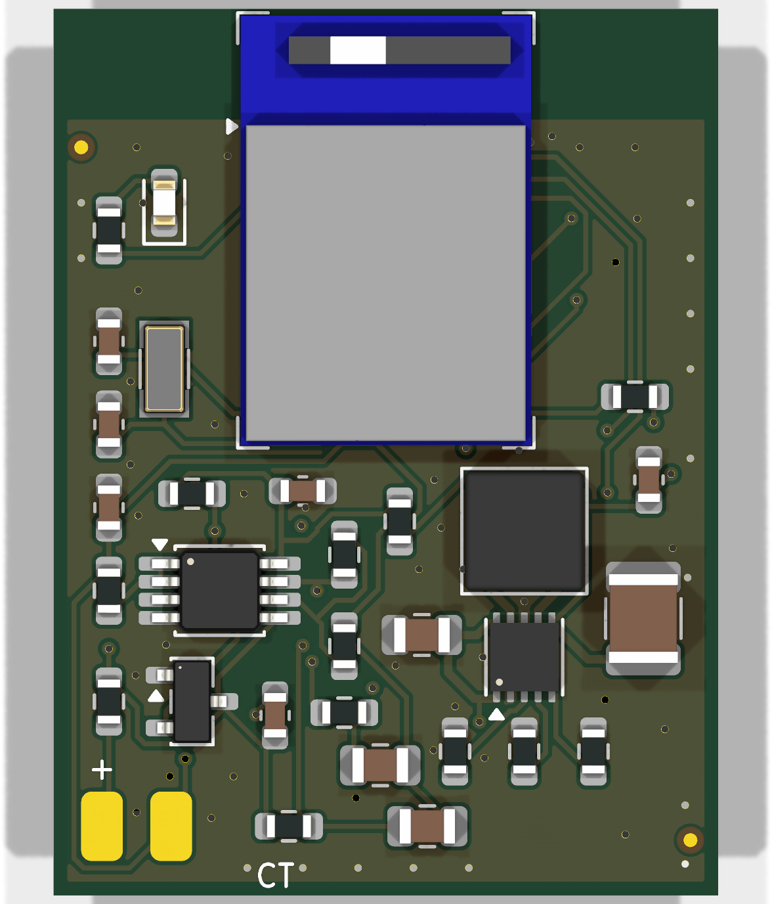
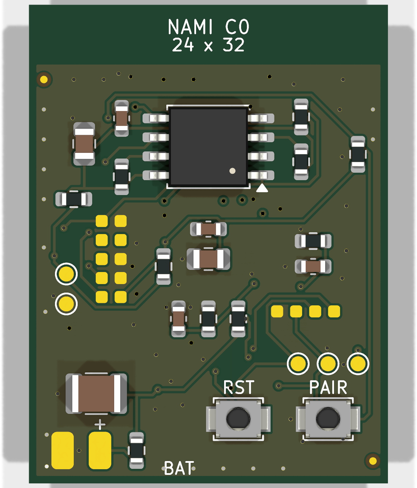
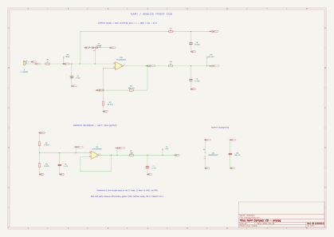
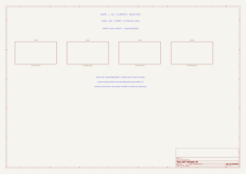
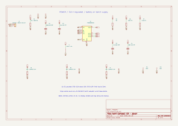
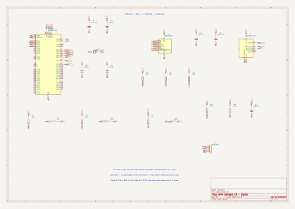
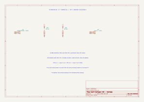

# Nami 波

An internal prototype for bolt-on equipment telemetry. A split-core current clamp senses the changing magnetic field around one insulated supply conductor without an electrical connection to it. The coin-cell-powered electronics sit in an enclosure outside the equipment. The intended application is 120/240 V AC, single-phase equipment up to 20 A; suitability for that installation remains to be validated.

Nami records one RMS current value each second, retains local history, and sends measurements over Thread to a powered local hub. BLE provides commissioning. The name means “wave”: we are picking up the waves from the wire and measuring them.

- [Product requirements and system diagrams](docs/PRD.md) — authoritative prototype specification.
- [Compact C0 hardware](hardware/nami-compact/README.md) — 24 × 32 mm, four-layer production layout candidate, renders and STEP model.
- [Rev A bench hardware](hardware/nami-rev-a/README.md) — KiCad schematics, routed PCB, BOM, verification and bring-up guide.
- [Earlier design explorations](docs/research/) — rationale and candidate circuits; superseded where they conflict with the PRD.

Status: bench and compact hardware design; feasibility validation remains. Native KiCad schematics and a routed prototype PCB are included; firmware and physical validation are not yet complete. Accuracy, battery life, packaging, and installation suitability remain unverified. The board is not a manufacturing or mains-installation release.

## Compact PCB

The compact C0 board is 24 × 32 mm with four copper layers. These snapshots show the current KiCad layout; the clamp, battery, and enclosure are external to the board.

| Front | Back |
| --- | --- |
|  |  |

[STEP model](hardware/nami-compact/exports/nami-compact.step) · [PCB layout](hardware/nami-compact/nami.kicad_pcb) · [Routing review](hardware/nami-compact/exports/routing-review.pdf)

## Schematics

The previews below are vector SVG exports from the compact KiCad project. Open an image to zoom in. The [complete schematic PDF](hardware/nami-compact/exports/nami-schematic.pdf) and [native KiCad schematic](hardware/nami-compact/nami.kicad_sch) are also available.

### Analog sensing

System overview

Power supply

Radio, processor, and storage

Clamp and wiring harness

