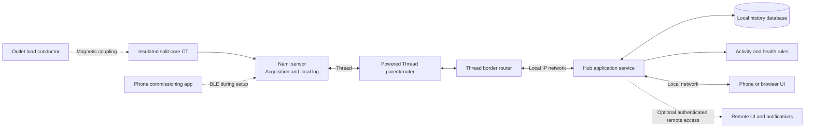
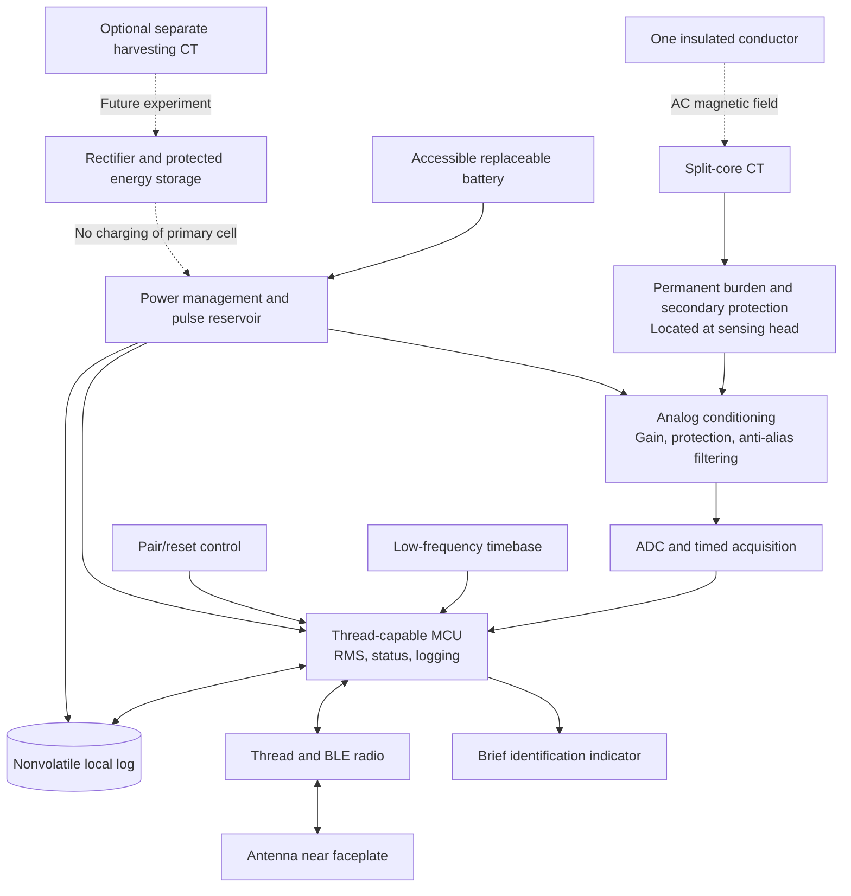
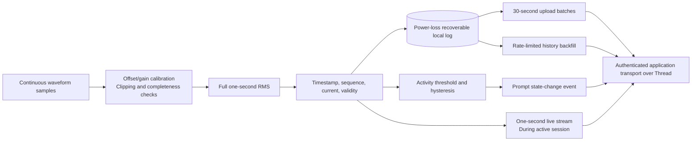
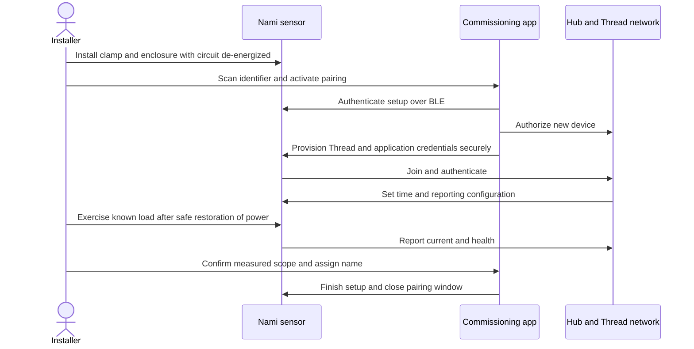
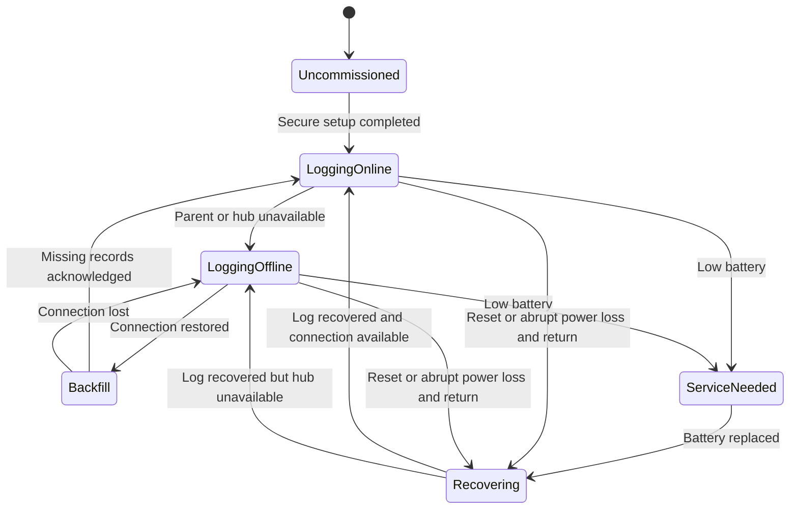

# Nami — product requirements

Version 0.1 · 2026-09-26 · Internal prototype

This document is the authoritative product baseline. It consolidates the earlier hardware, user-story and Thread explorations in `research/`. Requirements are intended behavior; no physical performance is claimed as achieved. Component selection and implementation details remain provisional.

Implementation reference: [Rev A bench hardware](../hardware/nami-rev-a/README.md) provides native KiCad schematics and a routed evaluation PCB. Its larger size, nRF52840 module and characterization front end are deliberate bench choices, not changes to the product's enclosure or battery-life targets.

## 1. Purpose

Nami measures the changing magnetic field around an existing insulated outlet conductor. It records current without cutting the conductor or making an electrical connection to it. The name 波, “wave,” reflects picking up the waves from the wire and measuring them.

The product answers: Is this appliance running? How much current does it draw? When did it run or stop? What happened while I was away?

The primary experience is a permanently installed sensor with a powered local hub. Measurements and history remain available without a phone being nearby or an internet connection. Optional remote access can expose the hub's information outside the home.

## 2. Scope and defaults

| Area | Prototype baseline |
|---|---|
| Electrical application | North American 120 V, 60 Hz, 15/20 A receptacle circuits |
| Measurement scope | One intended load or explicitly labeled group, determined by conductor topology |
| Coupling | Split-core current transformer around one insulated conductor |
| Quantity | AC true-RMS current over each complete consecutive one-second window |
| Accuracy target | ±10% of reference reading from 0.1–20 A RMS, after device calibration |
| Waveforms | Target crest factor up to 3; supported distorted-load envelope must be characterized |
| Local retention | At least 30 days of one-second readings |
| Persistence | At most 10 seconds of valid uncommitted measurements lost on abrupt power removal |
| Network | Thread Sleepy End Device; BLE for commissioning |
| Normal reporting | Upload all readings in batches every 30 seconds |
| Live reporting | One value per second during a bounded live-view session |
| Power | Replaceable battery; at least 12 months service-life target under the declared usage profile |
| Packaging | Serviceable faceplate electronics preferred; CT inside electrical box |
| Hub | Powered Thread border router plus local application, database and UI |
| Application protocol | Custom authenticated protocol for the prototype; Matter is deferred |
| Environment | Indoor, 0–50 °C target |

Non-goals: electrical protection, safety-critical alerts, revenue metering, accurate watts/kWh/cost, DC measurement, millisecond inrush analysis, universal fit in all outlet boxes, and initial consumer smart-home certification. Voltage and phase are not measured, so current must not be presented as measured real power.

## 3. User stories

| ID | Story | Product consequence |
|---|---|---|
| US-01 | As an installer, I need to know which load is measured. | Verify scope with a known load and reject or label combined/downstream loads. |
| US-02 | As an owner, I want monitoring without changing my plugs. | Preserve receptacle access and test bulky adapters as well as ordinary plugs. |
| US-03 | As an owner, I want battery service without exposing mains wiring. | A separate accessible battery compartment drives enclosure design. |
| US-04 | As a user, I want to see current and activity now. | Live view, configurable activity threshold and hysteresis, and clear freshness. |
| US-05 | As a user, I want history when my phone has been absent. | Autonomous logging, powered hub collection and 30-day local recovery buffer. |
| US-06 | As a user investigating a stop, I need the last available readings. | Short persistence interval, reboot markers and honest gaps. |
| US-07 | As a user, I want to know that a stopped appliance differs from a disconnected sensor. | Track current state and communication health independently. |
| US-08 | As an owner, I want the sensor reachable when the appliance is off. | Battery-backed operation independent of harvested energy. |
| US-09 | As an owner of several monitors, I need easy identification and secure setup. | Visible identifier, accessible pairing action, ownership and reset controls. |

These stories are inferred design inputs, not validated user-research findings.

## 4. Whole-system architecture

The parent/router, border router and application service may share one physical hub. They remain distinct logical roles. A border router routes packets; it does not automatically understand Nami measurements, store history or provide alerts. Battery sensors do not relay each other's packets. Additional coverage requires powered Thread routers. [OpenThread roles](https://openthread.io/guides/thread-primer/node-roles-and-types)

For the prototype, use a powered Linux-class host with an IEEE 802.15.4 radio coprocessor, OpenThread border-router software, and the Nami application service. Prefer Ethernet for the hub's upstream connection; Wi-Fi is acceptable at the powered hub. Exact host and radio are implementation selections, not required purchases.

## 5. Sensor hardware

HW-01: The CT encloses hot or neutral, never both together. The clamp must close repeatably without damaging conductor insulation. A simple helical winding around the wire is not the selected sensing geometry.

HW-02: The burden remains connected if the sensing cable is unplugged. Secondary protection and all insulation require circuit-level review. A CT's published dielectric test alone does not establish installation suitability.

HW-03: There must be an insulated mechanical route for the sensor lead and separation between user-accessible battery service and mains terminals. Faceplate packaging is a preference subject to fit and electrical review, not permission to route loose wiring through an arbitrary cover.

HW-04: Evaluate nRF54L15 for Thread/BLE and acquisition; nRF52840 is an alternative bench platform. The old nRF52832 proposal is superseded for the product because Thread requires appropriate radio support. No production MCU or module is locked. [Nordic nRF54L15](https://www.nordicsemi.com/Products/nRF54L15)

HW-05: Budget 16 MiB of low-power nonvolatile memory. Four bytes per second occupies 10,368,000 bytes in 30 days; remaining space accommodates metadata and spare sectors. Exact record encoding and flash device must be selected together.

HW-06: CR2450 is a battery candidate, not a fixed constraint. A larger accessible cell is acceptable if necessary. With 70% assumed usable capacity from a nominal 620 mAh cell, one year permits approximately 49.5 µA average draw. This planning calculation is not a runtime prediction. The earlier approximately 36 µA analog allocation is therefore too expensive to accept without comparison to alternatives. [Panasonic specification](https://energy.panasonic.com/dam/master/pdf/en/datasheet/lithium/CR2450_Datasheet_EN.pdf)

## 6. Measurement and local data pipeline

MEAS-01: Compute `Irms = sqrt(mean(i_sample²))` after calibrated conversion to instantaneous current. Do not replace a complete window with a brief once-per-second snapshot. Sampling rate, filter and ADC resolution are engineering choices validated against the supported waveforms.

MEAS-02: Achieve the accuracy target across the declared current, temperature, battery and waveform envelope. Crest factor alone does not specify bandwidth. CT frequency response, asymmetry/core saturation and harmonic energy require explicit testing before stating supported load types.

MEAS-03: Distinguish valid, below accurate range, clipped/overrange and incomplete-window measurements. Below 0.1 A may be an estimate; it is not an accurate zero. Characterize an activity detection floor separately from numeric accuracy.

MEAS-04: Keep acquisition running during logging and radio use. Mark any actual sampling gap. Device calibration belongs to manufacture or prototype characterization; installation must not require a precision instrument.

DATA-01: Store every one-second result and validity status for at least 30 days. After this retention interval, overwrite oldest records in a circular log. Never silently fabricate missing records.

DATA-02: Include device identity, boot/session identity, monotonic sequence, timestamp/time-validity mapping and integrity checks. Keep distinct measurement time and hub receipt time. Deduplicate retransmissions using identity/session/sequence.

DATA-03: Commit often enough that an abrupt battery removal loses at most 10 seconds of valid measurements. Recovery must tolerate interrupted programming and erase. Validate partial-page restrictions or select an alternative journal/staging design.

DATA-04: The hub supplies UTC; the device maintains monotonic time when disconnected. Preserve clock corrections and uncertain time instead of reordering history. Target normal synchronized timestamp error within two seconds; offline drift must be characterized and surfaced where relevant.

## 7. Connectivity and hub behavior

NET-01: Use a Thread Sleepy End Device. Keep BLE commissioning normally disabled after setup; optional diagnostics must require explicit authorization. The prototype application uses authenticated encrypted messages with per-device credentials. Thread network membership alone is not application authorization.

NET-02: Upload all one-second records in 30-second batches. Packetization must respect the transport; a batch need not fit in one radio packet. Hub acknowledgments identify persistently stored sequences, so retransmission cannot silently lose data.

NET-03: Emit activity-change events promptly following detection. Apply configurable thresholds, hysteresis and event rate limits. Events supplement the current record; they do not replace it or assert appliance-specific diagnosis.

NET-04: A live-view session lasts five minutes by default and can be renewed. During it, report once per second. Idle inbound poll interval starts near five seconds for prototype tuning; test command latency and energy together. Local outbound events need not wait for that poll.

NET-05: On loss of a parent/hub, continue local recording and use bounded retries with backoff. Recover automatically and backfill oldest missing records, with live events prioritized. Identify history overwritten during a long outage.

HUB-01: Provide device inventory, naming/location, current and activity view, one-second history inspection, summaries, CSV export, battery status, last contact and clock validity. Use an authenticated local web UI; a BLE-capable commissioning app/tool handles setup.

HUB-02: Retain at least 90 days of one-second data for ten sensors as the prototype sizing target, plus derived summaries. Provision database space from actual encoding and indexes. Confirmed sensor receipts must survive application restart. Long-term retention policy must be visible.

HUB-03: Distinguish appliance inactive, sensor unreachable, hub unavailable and remote-access unavailable. Initial missing-sensor threshold is three missed 30-second reporting periods. A hub cannot report its own total outage through its failed connection; remote availability supervision requires an independent service.

HUB-04: Local acquisition, collection, history and rules must work without internet. Remote UI/notifications are an optional extension requiring an authenticated remote path. The first prototype does not promise delivery of safety-critical alerts.

Matter is deferred to keep control of historical transfer and the hub experience. Future Matter integration must validate current-only device conformance and target controller support; current reporting does not imply support for Nami's historical archive. [CSA measurement overview](https://csa-iot.org/newsroom/matter-1-3-specification-released/)

## 8. Setup and ownership

SETUP-01: Support visible identifier/QR and a pairing action accessible after installation. Authenticate commissioning; provisioning details, key storage and recovery are engineering design tasks. Never embed reusable fleet-wide secrets in a public QR code.

SETUP-02: Confirm the intended receptacle positions and check downstream loads. An incoming feed or shared neutral can represent a different scope. If no suitable conductor is accessible, declare the clamp-only installation unsupported; do not silently expand measurement scope or require cutting the wire.

SETUP-03: Provide explicit ownership reset that removes credentials and history. Ordinary battery replacement preserves ownership, calibration and existing records; a clock reset creates a new identifiable session.

## 9. Power, reliability and servicing

The one-year battery target applies to full-second sampling, 10-second persistence, normal Thread operation, 30-second reporting, no harvesting credit, and one five-minute live session per day. Measure commissioning, history recovery, weak-link retries and firmware updates separately and publish their impact. Verify operation over realistic battery voltage/temperature, not nominal capacity alone.

Harvesting is an optional later experiment. Zero current yields no magnetic harvesting power; storage/battery must preserve sensing and communication during idle periods. A separate harvesting CT initially avoids altering the sensing burden. Never charge a primary coin cell. [TI reference architecture](https://www.ti.com/tool/TIDA-01385)

Low battery is a service condition: continue logging/communication while supply remains valid, and stop safely when it does not. Battery indicators must be based on characterized behavior, without false precision in remaining-life estimates. Reset recovery never turns a gap into zero current.

Require authenticated firmware updates with integrity checking and a recovery path after interruption. Final signing, rollback and bootloader strategy must be specified before field prototypes; reserve memory accordingly. No unauthenticated update endpoints.

## 10. Acceptance and feasibility gates

| Gate | Test and pass condition |
|---|---|
| Installation and fit | Demonstrate supported load isolation and safe packaging in representative metal/plastic boxes and ordinary/GFCI receptacles; verify plug clearance and isolated battery access. Document unsupported combinations. |
| Measurement | Reference uncertainty comfortably below 10%; test 0.1, 0.5, 2, 10 and 20 A, clamp reclosure, nearby conductors, temperature and battery extremes. Every supported condition meets ±10%, with truthful validity flags. |
| Waveforms | Test resistive, motor, charger, dimmer and intermittent loads; characterize crest factor, harmonics and asymmetry. Report exclusions instead of claiming unrestricted RMS accuracy. |
| Persistence | Fill and wrap 30 days; random cuts during writes/erase; no corrupt records accepted, no fabricated samples, at most 10 seconds of valid tail lost. |
| Local radio | With representative enclosure closed, reliable operation at 3 m from a powered parent; test ten sensors, coexistence and placement sensitivity. Do not infer whole-home coverage from this test. |
| Reporting | Under the declared healthy test network: normal readings arrive within 35 seconds, state changes within 5 seconds of detection, live mode begins within 10 seconds and delivers at least 99% of expected updates over ten minutes. These are prototype acceptance targets. |
| Recovery | Disconnect hub for 24 hours; sensor keeps logging, reconnects automatically and resumes backfill without duplicates. Target full backfill within 30 minutes on the declared ten-sensor test network, without disrupting acquisition. |
| Power | Measure full-system energy against the one-year usage profile; verify pulse sag and low-battery recovery. Battery target is a gate, not a promised consequence of Thread. |
| Hub | Ten-sensor ingest, 90-day storage sizing, restart recovery, export, live/history consistency, internet-off operation and explicit health states. |
| Security and setup | Reject unauthorized setup/data/update access; ownership reset erases prior access/history; ordinary servicing preserves ownership. |

Initial sensing experiments use an isolated low-voltage AC test loop. Permanent mains installation requires qualified review of enclosure, insulation, fault behavior, temperature and wiring space; installation is de-energized work by a qualified person. Regulatory/certification planning follows target-market selection and is not established by this PRD.

## 11. Delivery sequence and open engineering decisions

1. Validate conductor access and enclosure concepts before optimizing PCB size.
2. Characterize candidate CTs and analog acquisition with reference loads.
3. Measure sensing, persistence and Thread energy together; select battery, front end and MCU.
4. Build hub ingestion, setup, history, health and sensor outage recovery end to end.
5. Capture a reviewed schematic and PCB after feasibility gates support the product targets.
6. Evaluate harvesting only against the working battery-backed baseline.

Open decisions: exact CT and accuracy envelope; front end/ADC/filter; MCU module and antenna; enclosure and battery; flash/journal and update partitioning; application transport and commissioning credentials; hub hardware; remote-access mechanism. These are implementation choices to resolve through evidence, not missing user preferences that block initial experiments.

### Compact layout candidate

[Compact C0](../hardware/nami-compact/README.md) implements the Rev A circuit on a 24 × 32 mm, four-layer, double-sided PCB. Battery, clamp, harness and enclosure are external to that outline. This is a mechanical/layout candidate; it does not establish measurement accuracy, one-year battery life, installed RF performance or production qualification.
